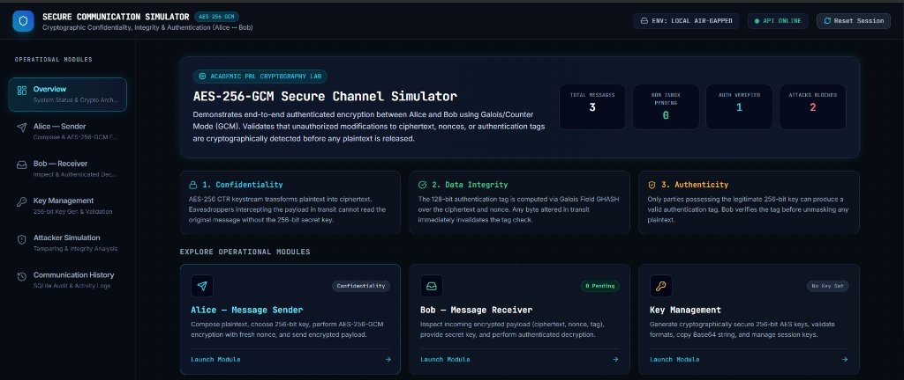
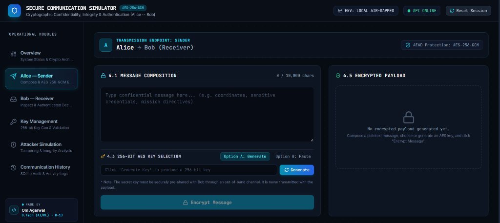
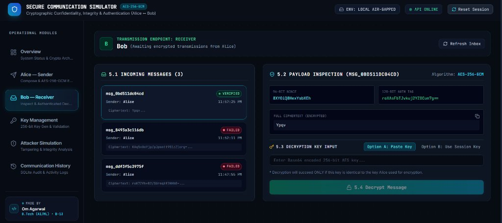
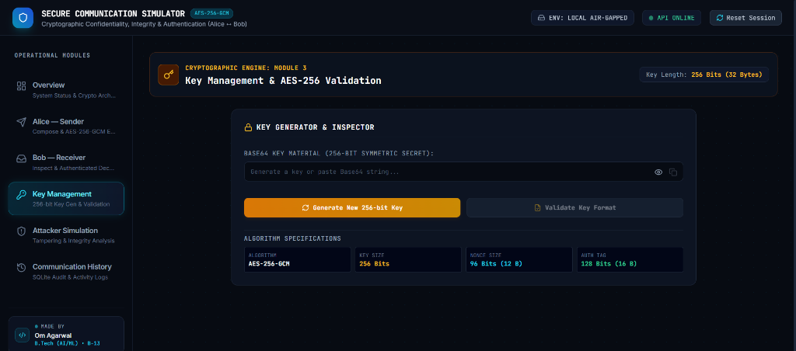
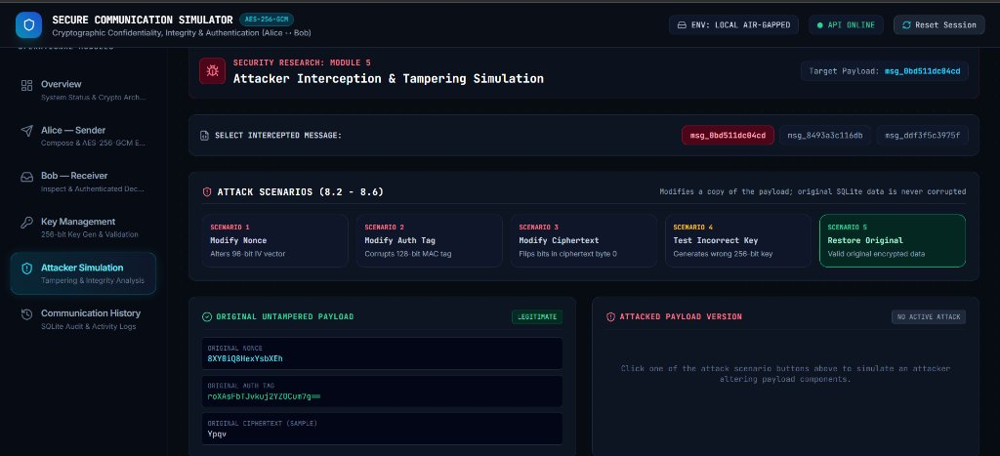
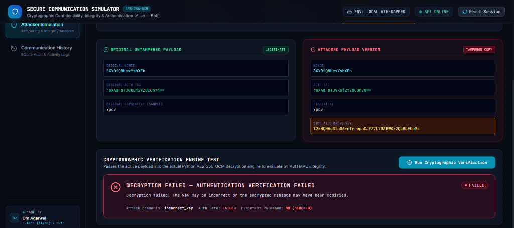
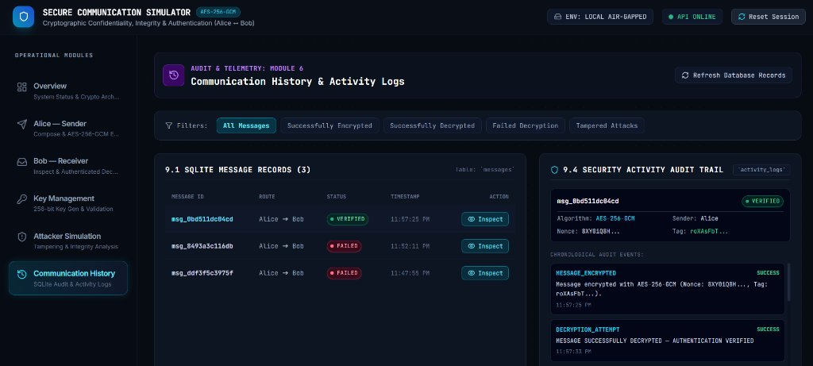

# Secure Communication Simulator (Alice ↔ Bob)

[](https://fastapi.tiangolo.com)
[](https://react.dev)
[](https://cryptography.io)
[](https://www.python.org)
[](https://tailwindcss.com)
[](LICENSE)

An interactive, educational cybersecurity web application demonstrating authentic, symmetric **AES-256-GCM** (Galois/Counter Mode) authenticated encryption between two entities: **Alice (Sender)** and **Bob (Receiver)**.

Designed as an academic Problem-Based Learning (PBL) project in **Cryptography and Network Security**, this simulator demonstrates the three fundamental pillars of modern communication security:

1. **Confidentiality:** AES-256 CTR keystream transforms plaintext into ciphertext. Eavesdroppers intercepting the payload in transit cannot read the message without the legitimate 256-bit symmetric key.
2. **Data Integrity:** The 128-bit authentication tag is computed via Galois Field GHASH over the ciphertext and nonce. Any byte altered in transit immediately invalidates the tag check.
3. **Authenticity:** AES-256-GCM provides message integrity and authentication of the encrypted data using the shared secret key. It verifies that the payload has not been modified and that the party generating it possesses the correct key. It does not provide non-repudiation or independently establish the sender's identity (since both Alice and Bob share the symmetric key).

> **Author / Student Credit:**  
> **Om Agarwal** — B.Tech (AI/ML), Section B-13  
> Academic PBL Project for Cryptography & Network Security

---

## Table of Contents

- [1. User Interface & Module Screenshots](#1-user-interface--module-screenshots)
  - [1.1 Overview Command Center](#11-overview-command-center)
  - [1.2 Alice — Message Sender](#12-alice--message-sender)
  - [1.3 Bob — Message Receiver](#13-bob--message-receiver)
  - [1.4 Key Management Laboratory](#14-key-management-laboratory)
  - [1.5 Attacker Interception & Tampering Simulation](#15-attacker-interception--tampering-simulation)
  - [1.6 Communication History & Audit Telemetry](#16-communication-history--audit-telemetry)
- [2. System Architecture](#2-system-architecture)
- [3. Cryptographic Engine Deep-Dive (AES-256-GCM)](#3-cryptographic-engine-deep-dive-aes-256-gcm)
- [4. Database Architecture: Zero Plaintext / Zero Secret-Key Persistence](#4-database-architecture-zero-plaintext--zero-secret-key-persistence)
- [5. REST API Endpoints](#5-rest-api-endpoints)
- [6. Installation & Quick Startup](#6-installation--quick-startup)
- [7. Evaluation Walkthrough](#7-evaluation-walkthrough)
- [8. License](#8-license)

---

## 1. User Interface & Module Screenshots

### 1.1 Overview Command Center

The centralized telemetry dashboard displays operational statistics, real-time counters (total transmissions, Bob inbox pending, verified decryptions, and blocked attacks), core security pillars, and quick navigation launchers.



---

### 1.2 Alice — Message Sender

Alice composes confidential messages up to 10,000 characters. She can generate a fresh 256-bit CSPRNG key or paste an existing one. Upon encryption, AES-256-GCM produces the Base64 ciphertext, a fresh 96-bit random nonce, and a 128-bit authentication tag, which can be dispatched directly to Bob.



---

### 1.3 Bob — Message Receiver

Bob inspects incoming transmissions in his inbox. The interface displays the encrypted payload (Nonce, Auth Tag, and Ciphertext) while plaintext remains locked. Bob can paste the key or use the in-memory session key to perform constant-time authenticated decryption.



---

### 1.4 Key Management Laboratory

A dedicated interface for generating 256-bit (32-byte) symmetric keys via CSPRNG (`os.urandom(32)`), inspecting key material with visibility toggles, and validating Base64 encoding and byte lengths. Secret keys are held strictly in ephemeral memory and are never persisted to disk.



---

### 1.5 Attacker Interception & Tampering Simulation

The simulation laboratory allows testing against an active adversary altering payload components in transit. Five attack scenarios can be tested:
1. **Scenario 1 — Modify Nonce:** Flips bits in the 96-bit initialization vector.
2. **Scenario 2 — Modify Auth Tag:** Corrupts the 128-bit MAC tag.
3. **Scenario 3 — Modify Ciphertext:** Flips bits in the ciphertext byte stream.
4. **Scenario 4 — Test Incorrect Key:** Decrypts with an unauthorized 256-bit key.
5. **Scenario 5 — Restore Original:** Reverts to the untampered payload.

When verification is executed against Python's OpenSSL-backed cryptographic engine, any tampering triggers an immediate authentication rejection without releasing any plaintext (`Plaintext Released: NO (BLOCKED)`).





---

### 1.6 Communication History & Audit Telemetry

The SQLite audit log records all message transmissions and security events with status filtering (`All`, `Successfully Encrypted`, `Successfully Decrypted`, `Failed Decryption`, `Tampered Attacks`). The **Inspect** action opens an interactive pop-up modal displaying verification status, transmission route, timestamps, and full cryptographic payload parameters.



---

## 2. System Architecture

```
┌─────────────────────────────────────────────────────────────────────────────────┐
│                           FRONTEND PRESENTATION LAYER                           │
│  React 18 + Vite + Tailwind CSS (Cyber Command Center Theme)                    │
│  - Overview Dashboard   - Alice Sender     - Bob Receiver                       │
│  - Key Management Lab   - Attacker Lab     - Communication History & Modal      │
└────────────────────────────────────────┬────────────────────────────────────────┘
                                         │ JSON / REST via Axios
                                         ▼
┌─────────────────────────────────────────────────────────────────────────────────┐
│                              FASTAPI BACKEND LAYER                              │
│  - /api/keys/*          : Key generation (CSPRNG) & 32-byte validation          │
│  - /api/encrypt         : AES-256-GCM authenticated encryption                  │
│  - /api/decrypt         : Tag-verified decryption with constant-time check      │
│  - /api/tamper & verify : Cryptographic tampering simulation engine             │
│  - /api/messages/*      : Dispatch queue & Bob inbox management                 │
│  - /api/history/*       : Telemetry queries & event logging                     │
└───────────────────────┬─────────────────────────────────┬───────────────────────┘
                        │                                 │
                        ▼                                 ▼
┌────────────────────────────────────────┐ ┌──────────────────────────────────────┐
│       CRYPTOGRAPHIC AEAD ENGINE        │ │            DATABASE LAYER            │
│  Python `cryptography` (OpenSSL)       │ │  SQLite + SQLAlchemy 2.0             │
│  - 256-bit Symmetric Key (32 Bytes)    │ │  - `messages` table (metadata & ct)  │
│  - Fresh 96-bit Random Nonce (12 Bytes)│ │  - `activity_logs` table (events)    │
│  - 128-bit GHASH Auth Tag (16 Bytes)   │ │  * ZERO PLAINTEXT PERSISTENCE        │
│  - InvalidTag Authentication Gate      │ │  * ZERO SECRET-KEY PERSISTENCE       │
└────────────────────────────────────────┘ └──────────────────────────────────────┘
```

---

## 3. Cryptographic Engine Deep-Dive (AES-256-GCM)

AES-GCM (Galois/Counter Mode) combines **Counter Mode (CTR)** encryption with **Galois Field polynomial multiplication (GHASH)** authentication into an Authenticated Encryption with Associated Data (AEAD) standard (NIST SP 800-38D):

### 1. Pre-Counter ($J_0$) vs. Encryption Counter ($\text{CTR}_1$)
- For a 96-bit nonce, GCM formats the pre-counter block $J_0$ by appending 31 zero bits and a single 1 bit:
  $$J_0 = \text{Nonce} \parallel 0^{31}1$$
- $J_0$ is reserved exclusively to encrypt the authentication tag mask:
  $$\text{Tag Mask} = \text{AES}_K(J_0)$$
- The first encryption counter block is obtained by incrementing $J_0$ modulo $2^{32}$ ($\text{inc}_{32}$), so its 32-bit suffix ends in **2**:
  $$\text{CTR}_1 = \text{inc}_{32}(J_0) = \text{Nonce} \parallel 0^{31}2$$
- Subsequent plaintext blocks $P_i$ are encrypted by generating keystream blocks:
  $$\text{Keystream}_i = \text{AES}_K(\text{CTR}_i), \quad C_i = P_i \oplus \text{Keystream}_i$$

### 2. GHASH Polynomial Authentication
- Hash subkey $H = \text{AES}_K(0^{128})$ is derived by encrypting a 128-bit block of zeros under the secret key.
- In general GCM, GHASH processes Additional Authenticated Data (AAD), ciphertext blocks, and a final 128-bit block encoding their bit lengths.
- In this implementation, message encryption sets $\text{AAD} = \emptyset$ ($\text{len}(\text{AAD}) = 0$). GHASH evaluates directly over ciphertext blocks followed by the length block $[0^{64} \parallel \text{len}_{64}(C)]$ in $\text{GF}(2^{128})$:
  $$S = \text{GHASH}_H(C \parallel 0^{64} \parallel \text{len}_{64}(C))$$
- The final 128-bit authentication tag XORs $S$ with the pre-counter mask:
  $$\text{Tag} = S \oplus \text{AES}_K(J_0)$$

### 3. Nonce Freshness & Collision Probability
- A fresh 96-bit cryptographically random nonce (`os.urandom(12)`) is generated for every encryption operation, making accidental nonce reuse extremely unlikely.

### 4. Decryption Integrity Gate
- During decryption, the receiver recomputes the expected tag over the received ciphertext and nonce.
- If the computed tag and received tag mismatch by even a single bit, **zero plaintext is released**, and `cryptography.exceptions.InvalidTag` is caught safely.

---

## 4. Database Architecture: Zero Plaintext / Zero Secret-Key Persistence

The SQLite database (`simulator.db`) stores encrypted payload components and operational metadata, but strictly enforces **Zero Plaintext / Zero Secret-Key Persistence**:

### Table: `messages`
| Column | Type | Description |
|---|---|---|
| `message_id` | VARCHAR(64) | Unique identifier (e.g. `msg_...`) |
| `sender` / `receiver` | VARCHAR(50) | Communication endpoints (`Alice` / `Bob`) |
| `algorithm` | VARCHAR(50) | `AES-256-GCM` |
| `ciphertext` | TEXT | Base64-encoded encrypted payload |
| `nonce` | VARCHAR(64) | Base64-encoded 96-bit initialization vector |
| `auth_tag` | VARCHAR(64) | Base64-encoded 128-bit MAC tag |
| `encryption_status` | VARCHAR(30) | `SUCCESS` |
| `decryption_status` | VARCHAR(30) | `PENDING`, `SUCCESS`, or `FAILED` |
| `authentication_status` | VARCHAR(30) | `PENDING`, `VERIFIED`, or `FAILED` |
| `created_at` / `decrypted_at` | DATETIME | Event timestamps (UTC) |

### Table: `activity_logs`
Chronological telemetry records tracking actions (`MESSAGE_ENCRYPTED`, `DECRYPTION_ATTEMPT`, `TAMPER_ATTACK`) with timestamps and sanitization.

---

## 5. REST API Endpoints

| Method | Endpoint | Description |
|---|---|---|
| `POST` | `/api/keys/generate` | Generates a fresh 256-bit CSPRNG Base64 key |
| `POST` | `/api/keys/validate` | Validates Base64 encoding and 32-byte key length |
| `POST` | `/api/encrypt` | Encrypts plaintext via AES-256-GCM with 96-bit random nonce |
| `POST` | `/api/decrypt` | Verifies 128-bit tag and decrypts ciphertext |
| `POST` | `/api/messages/send` | Dispatches encrypted payload to Bob's inbox |
| `GET` | `/api/messages/inbox` | Retrieves pending/processed transmissions for Bob |
| `POST` | `/api/tamper` | Simulates bit-flip attack on nonce, tag, or ciphertext |
| `POST` | `/api/verify` | Tests payload against the cryptographic decryption engine |
| `GET` | `/api/history` | Lists transmission records with status filtering |
| `GET` | `/api/history/{msg_id}` | Retrieves full message details and audit event trail |
| `GET` | `/api/health` | Backend status and engine specifications |

---

## 6. Installation & Quick Startup

### Prerequisites
- **Python 3.10+** (Tested on Python 3.13)
- **Node.js 18+** & **npm**

### Startup Instructions

```powershell
# Terminal 1: Backend (FastAPI)
cd c:\Users\hp\PycharmProjects\pbl_crypto
pip install -r backend/requirements.txt
$env:PYTHONPATH="backend"; python -m uvicorn app.main:app --host 127.0.0.1 --port 8000 --reload

# Terminal 2: Frontend (React + Vite)
cd c:\Users\hp\PycharmProjects\pbl_crypto\frontend
npm install
npm run dev
```

Open your browser at **`http://127.0.0.1:5173`**. Interactive Swagger documentation is available at **`http://127.0.0.1:8000/docs`**.

---

## 7. Evaluation Walkthrough

Follow this 4-step sequence during academic evaluation or viva:

1. **Demonstrate Confidentiality (Alice):** Generate a 256-bit key, write a confidential message, click **Encrypt Message**, and verify that only ciphertext, nonce, and tag are produced. Click **Send to Bob**.
2. **Demonstrate Authenticated Decryption (Bob):** In Bob's inbox, select the transmission, click **Use Session Key**, and decrypt. Observe the green `MESSAGE SUCCESSFULLY DECRYPTED — AUTHENTICATION VERIFIED` banner.
3. **Demonstrate Integrity & Tampering Resistance (Attacker):** In Attacker Simulation, alter the nonce, tag, or ciphertext, or test an incorrect key. Click **Run Cryptographic Verification** and observe that the authentication gate fails with zero plaintext leakage.
4. **Demonstrate Zero-Plaintext Storage (History):** In Communication History, inspect any message record. Point out that SQLite stores encrypted payloads and metadata only, never plaintext messages or secret keys.

---

## 8. License

This project is open-source under the [MIT License](LICENSE).  
Developed as an academic Problem-Based Learning (PBL) project for **Cryptography & Network Security**.
